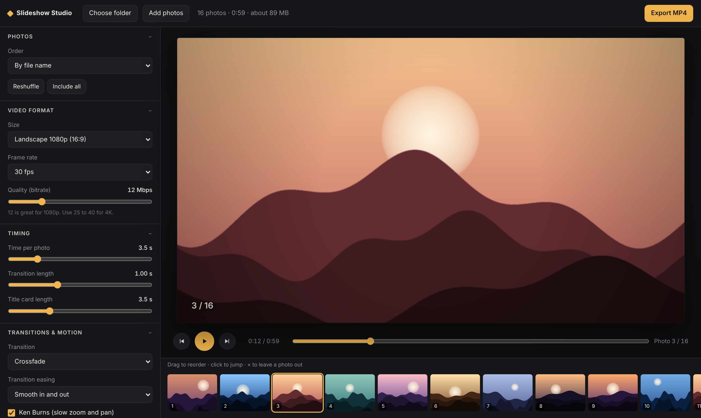

# Slideshow Studio

**Turn a folder of photos into a smooth MP4 slideshow, right in your browser.**
No install, no uploads, no account. Open one HTML file, pick a folder, tweak the look with a live preview, and export a real H.264 MP4.

## Features

- **Load a whole folder at once.** Pick it or drag it onto the window. Handles 100+ photos, sorted naturally (`IMG_2` comes before `IMG_10`).
- **Live preview** with play, scrub, next and previous. Keyboard: `Space`, `←`, `→`.
- **Reorder by dragging** thumbnails, or sort by name, date or shuffle. Click × to leave a photo out.
- **10 transitions:** crossfade, dip to black, flash, slide, slide up, zoom, wipe, circle reveal, blinds, or a random mix.
- **Ken Burns motion:** a slow zoom and pan on every photo, with adjustable strength.
- **Fit options:** fill the frame, or show the whole photo over a blurred copy of itself.
- **Text:** opening title card, ending card, per-photo captions (file name or counter), corner watermark, font and color choices.
- **Music:** add an MP3, M4A or WAV with volume, start offset, loop and fade-out, plus one click to fit the photo timing to the song length.
- **Output sizes:** 1080p, 4K, 720p, vertical 9:16 (Reels, Shorts, TikTok), 4:5 and square. 24, 30 or 60 fps with adjustable bitrate.
- **Fast, frame-perfect export:** each frame is rendered and encoded with WebCodecs, so no frames are dropped and it usually runs faster than real time. In Chrome the file streams straight to disk, so long 4K videos don't run out of memory.
- **Private:** your photos never leave your computer.

## Quick start

1. Download `index.html` (or clone this repo).
2. Open it in **Google Chrome** (recommended) or Safari 17+.
3. Click **Choose folder** and select your photo folder.
4. Adjust the settings in the left panel and watch the preview.
5. Click **Export MP4**.

Or use the hosted version: `https://delonation.github.io/slideshow-studio/`

## Browser support

| Browser | Export | Music in MP4 | HEIC photos |
|---|---|---|---|
| Chrome / Edge (desktop) | ✅ MP4, streamed to disk | ✅ AAC on macOS and Windows | ❌ convert to JPG first |
| Safari 17+ | ✅ MP4, kept in memory | ⚠️ depends on version | ✅ |
| Firefox | ⚠️ falls back to real-time recording (WebM) | ✅ | ❌ |

Photos the browser can't read are marked "can't read" in the strip and skipped automatically.

## Tips

- **Bitrate:** 12 Mbps looks great at 1080p. Use 25 to 40 Mbps for 4K.
- **Long videos:** about 100 photos at 3.5 s each is roughly 6 minutes. Leave **Loop** on for a shorter song, or use **Fit photo timing to the song**.
- **Background music:** Pixabay Music has free, royalty-free soft piano and ambient tracks.
- **Keep the tab visible** while exporting. Browsers slow down hidden tabs.
- Settings are saved in your browser. Photos aren't, so you choose the folder again each visit.

## How it works

Everything runs in a single self-contained HTML file:

1. Photos are read with the File API and decoded on demand with `createImageBitmap`. They are downscaled to the output size and kept in a small LRU cache, so memory stays low even with hundreds of photos.
2. Each frame is drawn on a `<canvas>`. Transitions are composited from two offscreen layers.
3. On export, every frame becomes a `VideoFrame` encoded by `VideoEncoder` (H.264). Music is mixed and encoded by `AudioEncoder` (AAC, or Opus where AAC isn't available).
4. [mp4-muxer](https://github.com/Vanilagy/mp4-muxer) packages the encoded streams into an `.mp4` file.

## Run it as a website (GitHub Pages)

1. Go to the repo's **Settings → Pages**.
2. Under **Source**, choose **Deploy from a branch**, then `main` and `/ (root)`.
3. After a minute it's live at `https://<your-username>.github.io/slideshow-studio/`.

## Roadmap ideas

- Multiple music tracks in sequence
- Per-photo duration and caption editing
- Beat-synced cuts
- Save and load projects

Pull requests and issues are welcome.

## License

[MIT](LICENSE) © 2026 Hammad Abid Hussain ([@Delonation](https://github.com/Delonation))

Includes [mp4-muxer](https://github.com/Vanilagy/mp4-muxer) v5.2.2 by Vanilagy, MIT licensed. See [LICENSE](LICENSE).
